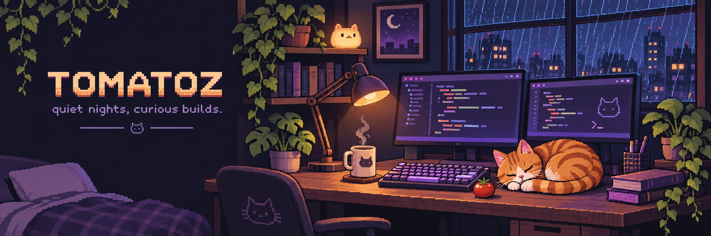

<p align="center">
  
</p>

<h1 align="center">Hey, I'm TOMATOZ 🐈</h1>
<p align="center"><samp>quiet nights, curious builds.</samp></p>
<p align="center">Python projects, useful tools, and a little curiosity.<br />Based in Thailand.</p>

---

### 🌙 On the workbench

| Project | What's inside |
| :--- | :--- |
| [crudeoil_mix_api](https://github.com/tomatoz1/crudeoil_mix_api) | A Python project for crude oil mixing. |
| [Cal-TF-2000](https://github.com/tomatoz1/Cal-TF-2000) | A Python calculation tool. |

### 🐾 Around here

```text
language    Python
location    Thailand
companion   one orange cat, supervising the keyboard
```

<p align="center"><samp>Face card declined. Personality pending. 🐈</samp></p>
